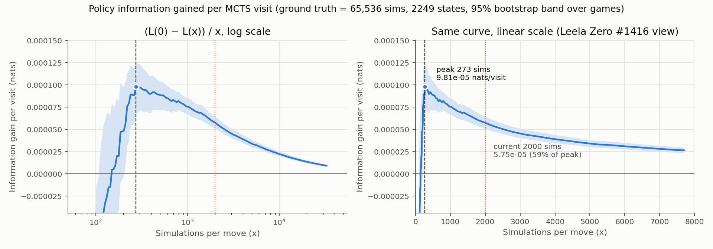

# Optimal search depth (information gain per MCTS visit)

The per-move simulation budget, chosen with the approach from Leela Zero
[issue #1416](https://github.com/leela-zero/leela-zero/issues/1416) described in the repo README.

**Result: information gain per visit peaks at ~270–300 simulations per move. At the current
2,000 sims, each visit is worth 59% of what it is worth at the peak.**



## Method

- **Model:** the final run's incumbent (`eerie-oyster-20260506-1858`, step 4,514,598) from the
  README's Google Drive folder. Search settings come from the run's `config.yaml` plus the
  incumbent state in `latest.pt`: `c_puct=1.5`, FPU = parent value, `nn_value_weight=1.0`,
  no penalties, `max_placements=50`.
- **States:** 96 self-play games played with the run's own self-play settings (2,000 sims,
  Dirichlet noise, `visit_sampling_epsilon=0.2`, fresh tree per move). Every 3rd decision is
  analysed, which gives 2,249 states. Hold decisions are included.
- **Snapshots:** for each state, one fresh-root search with no root noise and 65,536
  simulations. The root visit counts are recorded at 262 log-spaced budgets x. This uses
  `MCTSAgent.search_root_visit_snapshots`. Simulations run sequentially, so the snapshot at x
  is exactly the tree a standalone x-sim search would build (a Rust unit test checks this).
- **Metric:** with π_N = visit distribution at N sims (the "ground truth") and π_0 = network
  prior,
  - L(x) = KL(π_N ‖ π_x)
  - I(x) = (L(0) − L(x)) / x, in nats per visit
- **Smoothing:** π_x is zero on unvisited moves, which makes the KL infinite. So the prior
  counts as α pseudo-visits: π_x = (n_x + α·P) / (x + α). The headline uses α = 1, which makes
  π_0 exactly the prior.
- **Confidence band:** bootstrap over games, 1,000 resamples. Peaks are only searched over
  x ≤ N/2, because near N the two policies share most of their visits.

## Results (`results/summary.json`)

| | value |
|---|---|
| Peak (N=65,536, α=1) | **273 sims**, 9.8e-5 nats/visit |
| Within 90% of peak | 240 – 542 sims |
| Bootstrap 95% CI of peak location | 220 – 796 sims |
| Current 2,000 sims | 5.75e-5 nats/visit (59% of peak) |
| Mean KL to ground truth: prior → 2,000 sims | 0.319 → 0.204 nats |
| Mean valid actions / prior entropy / 65k-sim entropy | 24.7 / 0.79 / 0.39 nats |

**Robustness** (`results/sensitivity.png`):

| peak sims | α=0.25 | α=1 | α=4 |
|---|---|---|---|
| N=16,384 | 437 | 285 | 273 |
| N=32,768 | 437 | 297 | 273 |
| N=65,536 | 437 | 273 | 273 |

- **Ground-truth budget barely matters.** The peak stays put as N grows from 16k to 65k.
- **Smoothing moves it within 270–440.** It only changes the rising edge of the curve, where
  sparse visit counts are penalised.
- **Above ~1,000 sims, every setting gives the same curve.**

**By game phase** (`results/info_gain_by_game_phase.png`): early game (placements 0–16) peaks
around 240. Mid game peaks around 270. Late game (34–49) is flatter and peaks later, around
800: with a short remaining horizon, search keeps changing the prior for longer.

**Shape:** for x below about 150, I(x) is negative (`results/kl_vs_simulations.png`).
Early visits pile onto the prior's top moves, which takes π_x *further* from π_N than the
prior itself. Search only beats the raw prior after about 150 sims. Past the peak, the gain
per visit falls slowly: at 2,000 sims it is 59% of peak, and at 8,000 it is about 27%.

**Adopted:** `self_play.num_simulations` in the repo-root `config.yaml` changed from 2,000 to
**500** (2026-11-08). 300 was tried first, then raised after a playing-strength sweep run by a
separate perf session. That sweep used greedy play, the same final model, 144 fixed seeds and
18 workers:

| sims | avg attack | vs 2,000 | placements/s | speed vs 2,000 |
|---|---|---|---|---|
| 250 | 44.7 | −11.6% | 324 | 5.5× |
| 500 | 48.0 | −5.1% | 182 | 3.1× |
| 1,000 | 49.3 | −2.3% | 107 | 1.8× |
| 2,000 | 50.5 | — | 59 | 1× |

By interpolation, 300 sims would give up about 9% attack. Value targets come from game
outcomes, so 500 is the compromise: it stays on the information plateau (240–542), keeps 95% of
playing strength, and gives 3.1× more positions per hour. Only means were recorded, no
per-game spread, but every setting used the same seeds and the trend is the same at each step.

## Interpretation and caveats

- **Training budget:** for the policy target, about 300–500 sims per move gives the most
  policy information per unit of compute. That means roughly 4–7× more training positions
  for the same self-play compute as 2,000 sims, with each target somewhat noisier. Leela Zero
  reached the same kind of conclusion (800 vs 3,200).
- **Policy only:** like Leela's analysis, this measures only the policy target. It does not
  measure value-target quality or playing strength, and at very low sim counts the played
  moves (and so the value targets) get worse. Before switching, confirm with a
  fixed-seed `evaluate_model` sweep over e.g. {300, 500, 1000, 2000} sims, or a short
  training A/B.
- **Tree reuse:** these are fresh-root searches. Self-play uses `reuse_tree=true`, so each
  root already carries visits from the previous move. A 300-new-sim search with reuse
  therefore ends with more than 300 root visits, which makes a lower new-sim budget less
  costly than this curve suggests. A separate perf session measured that about 37% of root
  visits are carried over on average (56% after holds, 31% after placements). By that
  measure, 2,000 new sims ends at about 3,200 root visits, and 300 new sims at about 475.
  475 is still inside the within-90%-of-peak range (240–542). Not re-measured here.
- **Compute:** cost per visit is treated as constant. With the board-embedding cache, deeper
  trees cost slightly more per sim, which moves the compute-optimal point a little lower
  still.

## Reproduce

```bash
make build                                         # needs search_root_visit_snapshots
# put the Drive model in training_runs/drive_final/ (config.yaml, latest.pt, incumbent.* bundle)
investigations/optimal_search_depth/run.sh training_runs/drive_final
# or: make search-depth-info-gain ARGS="--run_dir training_runs/drive_final --num_workers 16"
# re-plot from saved curves without re-running searches:
investigations/optimal_search_depth/run.sh training_runs/drive_final --plot_only true
```

The full run took about 41 min with 16 workers on an 18-core M-series Mac (about 15 s per
state for the 65k-sim search under full load). Use `--num_games 48` or
`--ground_truth_simulations 8192 16384 32768` for a run about 2× faster; the peak estimate
is stable across both.

## Files

- `search_depth_info_gain.py`: collection, analysis and plots (`--plot_only true` re-plots).
- `run.sh`: wrapper with the worker count set from the machine.
- `results/summary.json`: headline numbers, sensitivity grid and run arguments.
- `results/kl_curves.npz`: `kl[state, ground_truth, alpha, grid]` plus `grid`, `ground_truths`,
  `alphas`. Not committed (16 MB, gitignored): `run.sh` writes it, and `--plot_only true` needs it.
- `results/states.jsonl`: per-state metadata (seed, placement, valid actions, entropies,
  timing).
- `results/*.png`: plots.
